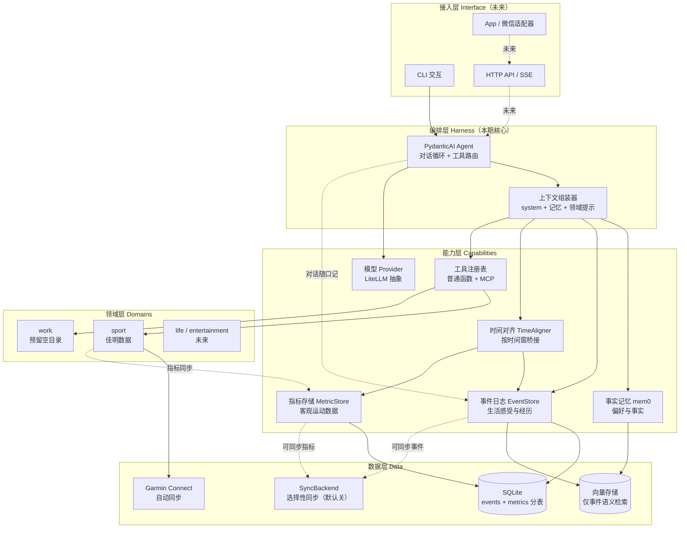

# 个人助理 Agent 应用 — 总体设计

> 版本 v0.3 · 2026-11-20 · 状态：**Phase 0 + Phase 1B 已实现并验证通过**（对话循环见 `03-Phase0-实现说明.md`；生活事件自动记录与回忆见 `04-Phase1B-实现说明.md`）
>
> 交付方式：分阶段实现，每阶段可独立运行、验证、展示，不一次性生成到位。

---

## 1. 项目定位

一个**本地优先、模型可插拔、带长期记忆**的个人 Agent 骨架（harness）。先跑通运动场景（佳明手表数据），把工作/生活等领域以插件方式留好扩展位，未来再接服务器与外部接口（App / 微信）。

### 已确认的边界

| 维度 | 决定 |
|---|---|
| 核心形态 | harness agent 作为核心，先本地部署调试，未来上服务器 |
| 外部接口 | 未来做 App / 微信等，作为接入层，不进核心 |
| 首批领域 | 运动（佳明手表）；工作保留空目录待扩展 |
| 核心能力 | **记忆与记录（核心子系统）**、对话式 Agent、信息聚合 |
| Agent 骨架 | PydanticAI（执行层轻量、结构化输出强） |
| 记忆中枢 | 短期上下文 + mem0 事实 + **客观指标 MetricStore** + **主观感受 EventStore** + TimeAligner 时间对齐；详见 `02-记忆与记录系统设计.md` |
| 记录内容 | 三类分开存：稳定事实（mem0）、客观运动数据（MetricStore）、生活感受与经历（EventStore） |
| 关键决策 | **客观运动数据与主观生活感受分开存储，按时间轴对齐桥接**（二者本质不同、关联性弱） |
| 记录方式 | 对话随口记→EventStore；佳明同步→MetricStore（无手动指令、无提醒补记） |
| 回忆方式 | 随时查 + 按主题 + 定期自动总结 + 时间线浏览 + 跨存储时间对齐 |
| 存储 | 本地为主 + 选择性同步（同步默认关闭；客观/主观数据可分别配置策略） |
| 模型接入 | 先留可插拔 Provider 接口，不绑定具体模型 |
| 佳明数据 | Garmin Connect 自动同步 → MetricStore（不进 EventStore、不做向量化） |
| 交付节奏 | 分阶段，每阶段可运行可验证 |

### 明确不做的事（本期）

- 不做多 Agent 编排（单 Agent 足够，CrewAI / AutoGen 的能力用不上）
- 不做前端界面（本期只要 CLI 能跑通，接口层留抽象）
- 不绑定任何模型厂商
- 不预设工作流引擎（LangGraph 作为未来可升级选项，不在本期引入）
- 不做云端同步的**实现**（只留 `SyncPolicy` 与 `SyncBackend` 接口，默认关闭）
- 不做手动"记一下"指令与提醒补记（记录全程自动）

---

## 2. 架构总览

### 2.1 分层图



### 2.2 关键设计决策

**为什么执行层用 PydanticAI**
- 佳明数据需要严格结构化（活动、睡眠、心率等字段），Pydantic 的类型校验是天然优势。
- 抽象薄，执行过程容易看穿，符合"一步一步调试"的诉求。
- 模型无关，配合 LiteLLM 可自由切换。
- 未来若需要复杂编排（分支、重试、人工审批），可把 PydanticAI Agent 作为节点嵌入 LangGraph，升级成本低。

**为什么记忆分层，且客观数据与主观感受分开存**（关键决策）
- 记忆与编排独立演进，接口按 `MemoryStore` / `EventStore` / `MetricStore` / `TimeAligner` 抽象，实现可换。
- mem0 只做**事实抽取**（偏好、身份），有损、无时间维度。
- **客观运动数据进 MetricStore**：机器生成、结构化、高频、量大，做聚合统计，不做向量化。
- **主观生活感受进 EventStore**：人生成、语义化、低频，带时间与情绪，做语义/主题检索。
- 两类数据本质不同、关联性弱，**分开存储**，避免海量指标淹没感受、无谓向量化开销、清理策略互相绑架。
- 用 **TimeAligner 按时间窗桥接**："跑10公里那天感觉如何" → 先查指标锚点，再查同窗口事件。
- 完整设计见 `02-记忆与记录系统设计.md`。同步默认关闭，客观/主观数据可分别配置策略。

**为什么工具走"普通函数 + MCP 双通道"**
- 领域能力先写成普通 Python 函数（PydanticAI 可直接注册为工具），调试最快。
- 同时预留 MCP 接口，未来接外部工具生态不用改 Agent 代码。

**为什么模型 Provider 要抽象**
- 用 LiteLLM 统一模型调用格式（OpenAI 兼容），配置化切换厂商。
- Agent 逻辑只依赖 `ModelProvider` 协议，不 import 任何厂商 SDK。

---

## 3. 目录结构

```
personal-assistant/
├── docs/
│   ├── 01-总体设计.md          # 本文档
│   └── 02-记忆与记录系统设计.md # 记忆中枢详细设计
├── src/assistant/
│   ├── core/                   # Harness 核心：Agent 构建、对话循环、上下文组装
│   ├── memory/                 # 事实记忆：MemoryStore 协议 + mem0 实现
│   ├── recall/                 # 主观记录：Event 模型、EventStore、抽取、Digest
│   ├── metrics/                # 客观指标：Metric 模型、MetricStore、同步游标
│   ├── alignment/              # 时间对齐：TimeAligner（桥接 metrics 与 recall）
│   ├── tools/                  # 工具注册表：函数工具 + MCP 适配
│   └── providers/              # 模型层：ModelProvider 协议 + LiteLLM 实现
├── domains/
│   ├── sport/                  # 运动领域：佳明数据同步、结构化、工具
│   └── work/                   # 工作领域：预留空目录，待扩展
├── data/                       # 本地数据：SQLite、缓存（gitignore）
├── tests/                      # 各阶段验证脚本
└── pyproject.toml              # 依赖与项目配置（Phase 0 创建）
```

---

## 4. 核心接口约定

以下接口是各阶段稳定的契约，实现可替换。

### 4.1 模型 Provider

```python
from typing import Protocol, AsyncIterator

class ModelProvider(Protocol):
    async def complete(self, messages: list[dict], **kwargs) -> str: ...
    async def stream(self, messages: list[dict], **kwargs) -> AsyncIterator[str]: ...
```

- 实现：`LiteLLMProvider`（配置 model name / api key / base url）
- 约束：任何厂商 SDK 不得出现在 `core/` 与 `domains/` 中

### 4.2 长期记忆

```python
from typing import Protocol

class MemoryStore(Protocol):
    async def add(self, user_id: str, messages: list[dict]) -> None: ...
    async def search(self, user_id: str, query: str, limit: int = 5) -> list[dict]: ...
    async def forget(self, user_id: str, memory_id: str) -> None: ...
```

- 实现：`Mem0Store`（Phase 1A）
- 替换成本：只换实现，Agent 与领域代码不动

### 4.3 客观指标存储 MetricStore

```python
class MetricStore(Protocol):
    async def upsert(self, metric: Metric) -> str: ...
    async def query(self, kind: str, start: datetime, end: datetime,
                    filters: dict | None = None) -> list[Metric]: ...
    async def sync_cursor(self) -> datetime | None: ...
    async def set_sync_cursor(self, ts: datetime) -> None: ...
```

- 存机器生成的客观数据（活动/睡眠/日指标），结构化、高频、不做向量化
- 写入路径：佳明同步 → `MetricEmitter` → MetricStore（**不进 EventStore**）
- 实现：SQLite 业务表（Phase 2）

### 4.4 主观记录 EventStore（核心）

```python
class EventStore(Protocol):
    async def append(self, event: Event) -> str: ...
    async def search(self, query: str, time_range: tuple | None = None,
                     tags: list[str] | None = None, limit: int = 10) -> list[Event]: ...
    async def by_topic(self, topic: str, time_range: tuple | None = None) -> list[Event]: ...
    async def timeline(self, start: datetime, end: datetime,
                       page: int = 0, size: int = 50) -> list[Event]: ...
```

- `Event`：id, occurred_at, recorded_at, source, type, title, content, tags, entities, mood, importance, metric_refs, embedding_ref
- 存人表达的经历与感受，语义化、低频、做向量检索
- 写入路径：对话后处理（随口记）→ EventStore
- 实现：SQLite + FTS5 + 本地向量库（Phase 1B）

### 4.5 时间对齐 TimeAligner

```python
class TimeAligner(Protocol):
    async def align_by_metric(self, metric_query: str, window_hours: int = 24) -> list[tuple]: ...
    async def align_by_event(self, event_query: str, window_hours: int = 24) -> list[tuple]: ...
```

- 按时间窗桥接 MetricStore 与 EventStore，支持"跑10公里那天感觉如何"类查询
- 对齐靠时间窗，不靠内容相似度；窗口可配置
- 完整定义见 `02-记忆与记录系统设计.md`

### 4.6 工具注册

```python
from typing import Callable

class ToolRegistry:
    def register(self, name: str, fn: Callable, description: str) -> None: ...
    def list_tools(self) -> list[dict]: ...
    def invoke(self, name: str, **kwargs): ...
```

- 领域工具通过 `register` 注入，核心不感知领域细节
- MCP 工具在 Phase 3 之后接入，统一转成同样的注册形式

### 4.7 领域插件

```python
from typing import Protocol

class Domain(Protocol):
    name: str
    description: str
    def tools(self) -> list[dict]: ...       # 暴露给 Agent 的工具
    def context(self) -> str: ...            # 注入的领域提示词
```

---

## 5. 首期场景：运动（佳明）

### 5.1 数据接入

- 库：`python-garminconnect`（非官方 Garmin Connect 客户端）
- 认证：账号密码 + MFA，凭据本地存放（`data/`，gitignore），不进代码库
- 同步数据：活动记录、睡眠、静息心率、步数、体重体脂
- 同步策略：增量拉取（按时间戳），写入 **MetricStore**（SQLite 业务表），失败可重试
- **不生成事件、不做向量化**——客观数据留在 MetricStore；主观感受由对话随口记进 EventStore，两者靠 TimeAligner 按时间对齐

### 5.2 数据结构（核心字段）

| 实体 | 关键字段 |
|---|---|
| Activity | id, type, start_time, duration, distance, calories, avg_hr, max_hr |
| Sleep | date, duration, deep, light, rem, awake, score |
| DailyMetric | date, steps, resting_hr, weight, body_fat |

### 5.3 典型交互（Phase 2 目标）

```
你：我上周跑得怎么样？
助理：上周你跑了 3 次，共 24.6 公里，平均配速 5'42"。
     周三那次 10 公里平均心率 148，比前一周同距离低了 6 次/分。
     睡眠平均 6h52"，比上周少 24 分钟。要我看看趋势图吗？
```

能力拆解：查询工具（活动/睡眠）→ 结构化结果 → Agent 归纳对比 → 长期记忆补充历史上下文。

### 5.4 信息聚合（Phase 3 目标）

- 每日/每周运动简报：活动 + 睡眠 + 心率趋势聚合
- 由定时任务触发（本地阶段用 CLI 手动触发，未来上服务器再定时）

---

## 6. 扩展位：工作领域

`domains/work/` 目前为空。后续按 `Domain` 协议接入，建议顺序：

1. 日程 / 待办查询与整理
2. 文档整理与摘要
3. 会议纪要
4. 邮件草稿（需外部 Connector，届时评估）

接入步骤：实现 `tools()` 与 `context()` → 在配置中启用 domain → Agent 自动获得工具，无需改核心。

---

## 7. 分阶段路线

> 每阶段结束都可运行、可验证、可展示；不跳阶段，不一次性生成到位。

| 阶段 | 目标 | 交付物 | 验证方式 |
|---|---|---|---|
| **Phase 0** ✅ | 骨架跑通（**已完成**） | 项目配置、`ModelProvider`、`ToolRegistry`、最小 Agent、CLI 对话；`Event`/`Metric` 模型与三个 Store 接口预留，post-turn hook 挂点 | 9 项测试通过 + CLI 端到端验证（详见 `03-Phase0-实现说明.md`） |
| **Phase 1A** | 事实记忆 | `MemoryStore` + mem0 实现，上下文组装接入记忆 | 两轮对话：第一轮说偏好，第二轮能回忆 |
| **Phase 1B** | 主观记录（核心）✅已实现 | `SQLiteEventStore` + FTS5/LIKE + `ModelEventExtractor` 随口记 + 4 个 `recall` 工具 | ✅ 随口说一句自动成事件；跨进程重开后能回忆/按主题查/统计；寒暄不记（详见 `04-Phase1B-实现说明.md`） |
| **Phase 2** | 客观运动数据 | Garmin Connect 同步 + `MetricStore` + 运动查询工具（**不生成事件**） | 拉到真实数据落到指标表，能查询归纳训练情况 |
| **Phase 3** | 聚合、回忆与对齐 | Digest 总结 + 时间线 + 主题回顾 + `TimeAligner` 跨存储对齐 | 生成运动周报；"跑10公里那天感觉如何"能对齐回答 |
| **Phase 4** | 工作扩展 | 填充 `domains/work/`，接入 1–2 个工作能力 | 工作工具能被 Agent 调用 |
| **Phase 5** | 上服务器 + 外部接口 | HTTP API / SSE、App / 微信适配器 | 通过 API 完成一次对话 |

每阶段完成后更新本文档状态，并单独出一份该阶段的实现说明。

---

## 8. 风险与开放问题

| 项 | 说明 | 应对 |
|---|---|---|
| Garmin 非官方库稳定性 | Garmin 可能改接口或加强风控，导致同步失败 | 抽象 `DataSource` 接口；同时支持 FIT/TCX 文件导入兜底 |
| 模型未定 | 本期只留接口，实际体验取决于后续选定的模型 | Provider 配置化，切换不动代码 |
| 记忆质量 | mem0 有损压缩，可能丢失细节 | 接口可替换；关键结构化数据存 SQLite 而非记忆层 |
| 凭据安全 | Garmin 账号密码、模型 key 本地存放 | 全部放 `data/` 并 gitignore；未来上服务器改密钥管理 |
| 客观/主观数据边界 | 什么进 mem0 / MetricStore / EventStore 需明确 | 三类分开：事实偏好进 mem0，机器客观数据进 MetricStore，人的经历感受进 EventStore；只在查询时按时间对齐 |
| 时间对齐窗口 | 窗口太大引入无关事件，太小漏掉 | 窗口可配置，默认当天；回答时展示时间便于校准 |
| 自动记录误记/漏记 | 随口记的判定可能出错 | 规则+轻量模型判定；事件可删改；调试期可关闭；详见 02 文档 |
| 记忆膨胀与成本 | 事件长期积累 + 每轮抽取的 LLM 开销 | 轻量模型判定；按时间分区；摘要后归档原始事件；指标不做向量化 |

---

## 9. 下一步

从 **Phase 0** 开始：创建 `pyproject.toml`，实现 `ModelProvider`、`ToolRegistry` 与最小 Agent，配一个可用模型跑通第一轮对话，并在对话循环里留好 post-turn hook 挂点与 `Event`/`Metric` 模型及 `EventStore`/`MetricStore`/`TimeAligner` 接口定义。等你确认后再进 Phase 1A。

记忆中枢的完整设计（三类数据分开存的决策、数据模型、自动记录机制、四种回忆 + 时间对齐、同步策略、接口）见 **`02-记忆与记录系统设计.md`**。

（本文档会随各阶段推进持续更新。）
