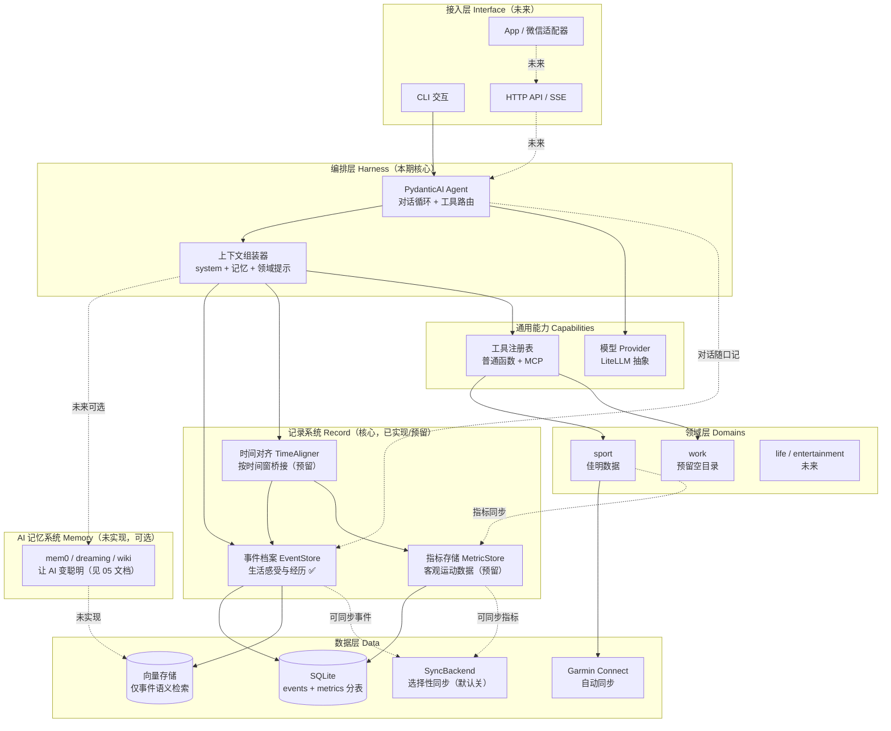

# 个人助理 Agent 应用 — 总体设计

> 版本 v1.0 · 2026-11-23 · 状态：**Phase 0 + Phase 1B 已实现并验证通过**（对话循环见 `03-Phase0-实现说明.md`；生活事件自动记录与回忆见 `04-Phase1B-实现说明.md`）
>
> 交付方式：分阶段实现，每阶段可独立运行、验证、展示，不一次性生成到位。
>
> **v1.0 重要变更：文档体系拆分**——「记录系统」（`02`，用户自己的事件档案，已实现）与「AI 记忆系统」（`05`，让 AI 变聪明，未实现）是**两件完全无关的事**，不再放在同一叙事框架里。本文档中凡"记录"指前者，"记忆"仅指后者。

---

## 1. 项目定位

一个**本地优先、模型可插拔、带个人事件记录**的个人 Agent 骨架（harness）。先跑通运动场景（佳明手表数据），把工作/生活等领域以插件方式留好扩展位，未来再接服务器与外部接口（App / 微信）。

> 注意：这里的核心是「**个人事件记录**」（用户自己的档案），不是「AI 记忆系统」。后者尚未实现、且可选，当前不展开。

### 已确认的边界

| 维度 | 决定 |
|---|---|
| 核心形态 | harness agent 作为核心，先本地部署调试，未来上服务器 |
| 外部接口 | 未来做 App / 微信等，作为接入层，不进核心 |
| 首批领域 | 运动（佳明手表）；工作保留空目录待扩展 |
| 核心能力 | **个人事件记录（核心子系统）**、对话式 Agent、信息聚合 |
| Agent 骨架 | PydanticAI（执行层轻量、结构化输出强） |
| 记录系统 | **主观感受 EventStore**（已实现）+ **客观指标 MetricStore**（预留）+ TimeAligner 时间对齐；详见 `02-记录系统设计.md` |
| AI 记忆系统 | mem0 / dreaming / wiki 等让 AI 变聪明的机制——**未实现、可选**，当前不展开 |
| 记录内容 | 两类分开存：客观运动数据（MetricStore）、生活感受与经历（EventStore）。**不含 AI 事实记忆** |
| 关键决策 | **客观运动数据与主观生活感受分开存储，按时间轴对齐桥接**（二者本质不同、关联性弱） |
| 记录方式 | 对话随口记→EventStore；佳明同步→MetricStore（无手动指令、无提醒补记） |
| 回忆方式 | 随时查 + 按主题 + 定期自动总结 + 时间线浏览 + 跨存储时间对齐 |
| 存储 | 本地为主 + 选择性同步（同步默认关闭；客观/主观数据可分别配置策略） |
| 模型接入 | 先留可插拔 Provider 接口，不绑定具体模型 |
| 佳明数据 | Garmin Connect 自动同步 → MetricStore（不进 EventStore、不做向量化） |
| 交付节奏 | 分阶段，每阶段可运行可验证 |

### 明确不做的事（本期）

- 不做多 Agent 编排（单 Agent 足够，CrewAI / AutoGen 的能力用不上）
- 不做前端界面（本期只要 CLI 能跑通，接口层留抽象）
- 不绑定任何模型厂商
- 不预设工作流引擎（LangGraph 作为未来可升级选项，不在本期引入）
- 不做云端同步的**实现**（只留 `SyncPolicy` 与 `SyncBackend` 接口，默认关闭）
- 不做手动"记一下"指令与提醒补记（记录全程自动）

---

## 2. 架构总览

### 2.1 分层图



> 图中「记录系统」与「AI 记忆系统」是两组独立节点：前者服务用户、已实现；后者服务 AI、未实现。二者唯一可能的联系是记忆系统将来**读取**事件档案作为素材（单向），见 `05`。

### 2.2 关键设计决策

**为什么执行层用 PydanticAI**
- 佳明数据需要严格结构化（活动、睡眠、心率等字段），Pydantic 的类型校验是天然优势。
- 抽象薄，执行过程容易看穿，符合"一步一步调试"的诉求。
- 模型无关，配合 LiteLLM 可自由切换。
- 未来若需要复杂编排（分支、重试、人工审批），可把 PydanticAI Agent 作为节点嵌入 LangGraph，升级成本低。

**为什么记录系统里，客观数据与主观感受分开存**（关键决策）
- 记录系统与编排独立演进，接口按 `EventStore` / `MetricStore` / `TimeAligner` 抽象，实现可换。
- **客观运动数据进 MetricStore**：机器生成、结构化、高频、量大，做聚合统计，不做向量化。
- **主观生活感受进 EventStore**：人生成、语义化、低频，带时间与情绪，做语义/主题检索。
- 两类数据本质不同、关联性弱，**分开存储**，避免海量指标淹没感受、无谓向量化开销、清理策略互相绑架。
- 用 **TimeAligner 按时间窗桥接**："跑10公里那天感觉如何" → 先查指标锚点，再查同窗口事件。
- 完整设计见 `02-记录系统设计.md`。同步默认关闭，客观/主观数据可分别配置策略。

**为什么把 AI 记忆系统单独拆出去**（关键决策）
- 记录系统（存用户自己的事件档案）与 AI 记忆系统（让 AI 变聪明的目标）**本质无关**：前者不依赖 AI 也有价值，后者才有"AI 是否记住"的问题。
- 用户明确要求两者在命名、叙事、文档上彻底分离——不要把 EventStore 称作"记忆"。
- AI 记忆系统当前**未实现、可选**，是否启用取决于真实使用中是否出现痛点，当前不展开。

**为什么工具走"普通函数 + MCP 双通道"**
- 领域能力先写成普通 Python 函数（PydanticAI 可直接注册为工具），调试最快。
- 同时预留 MCP 接口，未来接外部工具生态不用改 Agent 代码。

**为什么模型 Provider 要抽象**
- 用 LiteLLM 统一模型调用格式（OpenAI 兼容），配置化切换厂商。
- Agent 逻辑只依赖 `ModelProvider` 协议，不 import 任何厂商 SDK。

---

## 3. 目录结构

```
personal-assistant/
├── docs/
│   ├── 01-总体设计.md                    # 本文档
│   ├── 02-记录系统设计.md                # 记录系统（用户档案，核心，已实现）
│   ├── 03-Phase0-实现说明.md             # Phase 0 验证记录
│   └── 04-Phase1B-实现说明.md            # Phase 1B 验证记录
├── src/assistant/
│   ├── core/                   # Harness 核心：Agent 构建、对话循环、上下文组装
│   ├── memory/                 # AI 记忆系统：MemoryStore 协议占位（未实现）
│   ├── recall/                 # 记录系统：Event 模型、EventStore、抽取、Digest
│   ├── metrics/                # 客观指标：Metric 模型、MetricStore、同步游标
│   ├── alignment/              # 时间对齐：TimeAligner 协议预留（未实现）
│   ├── tools/                  # 工具注册表：函数工具 + MCP 适配
│   └── providers/              # 模型层：ModelProvider 协议 + LiteLLM 实现
├── domains/
│   ├── sport/                  # 运动领域：官方 Personal API 客户端 + 数据同步落库
│   └── work/                   # 工作领域：预留空目录，待扩展
├── data/                       # 本地数据：SQLite、缓存（gitignore）
├── tests/                      # 各阶段验证脚本
└── pyproject.toml              # 依赖与项目配置（Phase 0 创建）
```

---

## 4. 核心接口约定

以下接口是各阶段稳定的契约，实现可替换。

### 4.1 模型 Provider

```python
from typing import Protocol, AsyncIterator

class ModelProvider(Protocol):
    async def complete(self, messages: list[dict], **kwargs) -> str: ...
    async def stream(self, messages: list[dict], **kwargs) -> AsyncIterator[str]: ...
```

- 实现：`LiteLLMProvider`（配置 model name / api key / base url）
- 约束：任何厂商 SDK 不得出现在 `core/` 与 `domains/` 中

### 4.2 AI 记忆系统（未实现，可选）

> 这属于「AI 记忆系统」，不是记录系统。当前只有协议占位，**无实现**。是否启用取决于真实使用痛点，当前不展开。

```python
from typing import Protocol

class MemoryStore(Protocol):
    async def add(self, user_id: str, messages: list[dict]) -> None: ...
    async def search(self, user_id: str, query: str, limit: int = 5) -> list[dict]: ...
    async def forget(self, user_id: str, memory_id: str) -> None: ...
```

- 状态：**未实现**（早期规划的 Phase 1A mem0，现暂缓）
- 与记录系统的关系：单向——将来若实现，可读取事件档案作为素材，但不写回事件库
- 替换成本：只换实现，Agent 与领域代码不动

### 4.3 客观指标存储 MetricStore

```python
class MetricStore(Protocol):
    async def upsert(self, metric: Metric) -> str: ...
    async def query(self, kind: str, start: datetime, end: datetime,
                    filters: dict | None = None) -> list[Metric]: ...
    async def sync_cursor(self) -> datetime | None: ...
    async def set_sync_cursor(self, ts: datetime) -> None: ...
```

- 存机器生成的客观数据（活动/睡眠/日指标），结构化、高频、不做向量化
- 写入路径：佳明同步 → `MetricEmitter` → MetricStore（**不进 EventStore**）
- 实现：SQLite 业务表（Phase 2）

### 4.4 主观记录 EventStore（记录系统核心，已实现）

```python
class EventStore(Protocol):
    async def append(self, event: Event) -> str: ...
    async def search(self, query: str, time_range: tuple | None = None,
                     tags: list[str] | None = None, limit: int = 10) -> list[Event]: ...
    async def by_topic(self, topic: str, time_range: tuple | None = None) -> list[Event]: ...
    async def timeline(self, start: datetime, end: datetime,
                       page: int = 0, size: int = 50) -> list[Event]: ...
```

- `Event`：id, occurred_at, recorded_at, source, type, title, content, tags, entities, mood, importance, metric_refs, embedding_ref
- 存人表达的经历与感受，语义化、低频、做向量检索
- 写入路径：对话后处理（随口记）→ EventStore
- 实现：SQLite + FTS5 + 本地向量库（Phase 1B）

### 4.5 时间对齐 TimeAligner

```python
class TimeAligner(Protocol):
    async def align_by_metric(self, metric_query: str, window_hours: int = 24) -> list[tuple]: ...
    async def align_by_event(self, event_query: str, window_hours: int = 24) -> list[tuple]: ...
```

- 按时间窗桥接 MetricStore 与 EventStore，支持"跑10公里那天感觉如何"类查询
- 对齐靠时间窗，不靠内容相似度；窗口可配置
- 完整定义见 `02-记录系统设计.md`

### 4.6 工具注册

```python
from typing import Callable

class ToolRegistry:
    def register(self, name: str, fn: Callable, description: str) -> None: ...
    def list_tools(self) -> list[dict]: ...
    def invoke(self, name: str, **kwargs): ...
```

- 领域工具通过 `register` 注入，核心不感知领域细节
- MCP 工具在 Phase 3 之后接入，统一转成同样的注册形式

### 4.7 领域插件

```python
from typing import Protocol

class Domain(Protocol):
    name: str
    description: str
    def tools(self) -> list[dict]: ...       # 暴露给 Agent 的工具
    def context(self) -> str: ...            # 注入的领域提示词
```

---

## 5. 首期场景：运动（佳明）

### 5.1 数据接入

- 方案：Garmin **官方 Connect Personal API**（中国区 `personal.connectapi.garmin.cn`），已整体替换早前的非官方账号密码方案
- 认证：两步——裸 key（`GCDC_` 开头，存 `.env_garmin`）换 JWT → Bearer 调数据端点；无账号密码、无 MFA、无 token 缓存。详见 `07-Garmin-Personal-API-调试报告.md`
- 同步数据：11 类（活动、睡眠、每日摘要、步数、HRV、静息心率、心率、压力、身体电量、体重、健身年龄）
- 同步策略：官方区间端点一次拉一段，写入 **MetricStore**（独立 `metrics.db`），单类失败隔离、增量游标
- **不生成事件、不做向量化**——客观数据留在 MetricStore；主观感受由对话随口记进 EventStore
- 使用入口：同步 `scripts/sync_garmin.py`，查询 `scripts/query_metrics.py`
- 当前**不做**命令行对话接入与 Agent 工具；时间对齐（TimeAligner）仅为协议预留

### 5.2 数据结构（核心字段）

| 实体 | 关键字段 |
|---|---|
| Activity | id, type, start_time, duration, distance, calories, avg_hr, max_hr |
| Sleep | date, duration, deep, light, rem, awake, score |
| DailyMetric | date, steps, resting_hr, weight, body_fat |

### 5.3 典型交互（Phase 2 目标）

```
你：我上周跑得怎么样？
助理：上周你跑了 3 次，共 24.6 公里，平均配速 5'42"。
     周三那次 10 公里平均心率 148，比前一周同距离低了 6 次/分。
     睡眠平均 6h52"，比上周少 24 分钟。要我看看趋势图吗？
```

能力拆解：查询工具（活动/睡眠）→ 结构化结果 → Agent 归纳对比 → （可选）历史记录档案补充上下文。

### 5.4 信息聚合（Phase 3 目标）

- 每日/每周运动简报：活动 + 睡眠 + 心率趋势聚合
- 由定时任务触发（本地阶段用 CLI 手动触发，未来上服务器再定时）

---

## 6. 扩展位：工作领域

`domains/work/` 目前为空。后续按 `Domain` 协议接入，建议顺序：

1. 日程 / 待办查询与整理
2. 文档整理与摘要
3. 会议纪要
4. 邮件草稿（需外部 Connector，届时评估）

接入步骤：实现 `tools()` 与 `context()` → 在配置中启用 domain → Agent 自动获得工具，无需改核心。

---

## 7. 分阶段路线

> 每阶段结束都可运行、可验证、可展示；不跳阶段，不一次性生成到位。

| 阶段 | 目标 | 交付物 | 验证方式 |
|---|---|---|---|
| **Phase 0** ✅ | 骨架跑通（**已完成**） | 项目配置、`ModelProvider`、`ToolRegistry`、最小 Agent、CLI 对话；`Event`/`Metric` 模型与三个 Store 接口预留，post-turn hook 挂点 | 9 项测试通过 + CLI 端到端验证（详见 `03-Phase0-实现说明.md`） |
| **Phase 1B** ✅ | 主观记录（核心，已完成） | `SQLiteEventStore` + FTS5/LIKE + `ModelEventExtractor` 随口记 + 4 个 `recall` 工具 | ✅ 随口说一句自动成事件；跨进程重开后能回忆/按主题查/统计；寒暄不记（详见 `04-Phase1B-实现说明.md`） |
| **Phase 2** ✅ | 客观运动数据（官方 API，已真实同步验证） | `SQLiteMetricStore` + Garmin 官方 Personal API 客户端 + 11 类抓取器 + 两个独立脚本（同步 / 查询），**不接对话、不做 Agent 工具、不生成事件** | ✅ 已用真实中国区 key 同步落库并查询验证；35 项测试通过，详见 `07-Garmin-Personal-API-调试报告.md` |
| **Phase 3** | 聚合、回忆与对齐 | Digest 总结 + 时间线 + 主题回顾 + `TimeAligner` 跨存储对齐 | 时间线/主题已实现；时间对齐仅协议预留，当前不做；Digest 周报待做 |

> **关于原 Phase 1A（mem0 事实记忆）**：属于 AI 记忆系统，已暂缓——当前不做，是否启用看真实使用痛点。
| **Phase 4** | 工作扩展 | 填充 `domains/work/`，接入 1–2 个工作能力 | 工作工具能被 Agent 调用 |
| **Phase 5** | 上服务器 + 外部接口 | HTTP API / SSE、App / 微信适配器 | 通过 API 完成一次对话 |

每阶段完成后更新本文档状态，并单独出一份该阶段的实现说明。

---

## 8. 风险与开放问题

| 项 | 说明 | 应对 |
|---|---|---|
| Garmin 非官方库稳定性 | Garmin 可能改接口或加强风控，导致同步失败 | 抽象 `DataSource` 接口；同时支持 FIT/TCX 文件导入兜底 |
| 模型未定 | 本期只留接口，实际体验取决于后续选定的模型 | Provider 配置化，切换不动代码 |
| AI 记忆是否值得做 | 记忆系统常不如朴素全上下文，可能帮倒忙 | 当前不做；先用记录系统，出现明确痛点再评估，见 05 文档 |
| 凭据安全 | Garmin Personal API Key、模型 key 本地存放 | 放 `.env_garmin` 等文件并 gitignore；未来上服务器改密钥管理 |
| 客观/主观数据边界 | 什么进 MetricStore / EventStore 需明确 | 两类分开：机器客观数据进 MetricStore，人的经历感受进 EventStore；只在查询时按时间对齐 |
| 时间对齐窗口 | 窗口太大引入无关事件，太小漏掉 | 窗口可配置，默认当天；回答时展示时间便于校准 |
| 自动记录误记/漏记 | 随口记的判定可能出错 | 规则+轻量模型判定；事件可删改；调试期可关闭；详见 02 文档 |
| 事件膨胀与成本 | 事件长期积累 + 每轮抽取的 LLM 开销 | 轻量模型判定；按时间分区；摘要后归档原始事件；指标不做向量化 |

---

## 9. 下一步

**当前状态**：Phase 0 与 Phase 1B 已完成。建议先用自己的记录系统真实用一段时间（随口记 → 查 → 回忆），让使用暴露问题，再决定下一步补什么——不要提前堆功能。

**两条独立的演进线，文档各自维护**：

- **记录系统（核心，已实现）**：数据模型、自动记录、回忆方式、同步策略、接口——见 **`02-记录系统设计.md`**。下一步候选：接向量语义检索、Digest 周/月报。
- **AI 记忆系统（未实现，可选）**：让 AI 变聪明的事实/规则/wiki/dreaming。当前不做，出现明确痛点再启用。

（本文档会随各阶段推进持续更新。）
